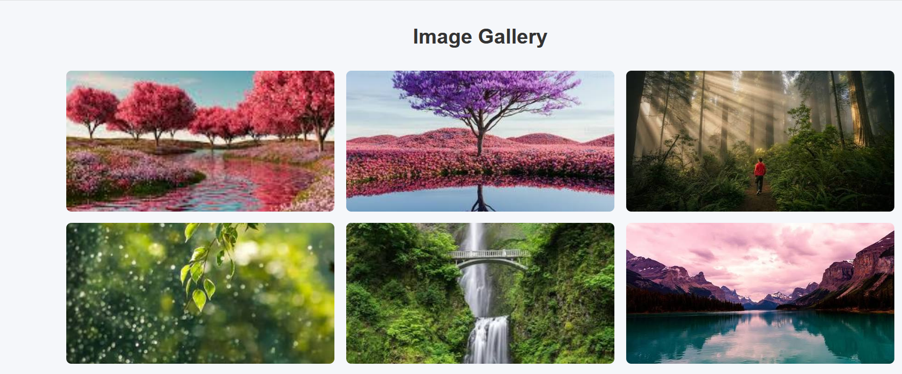
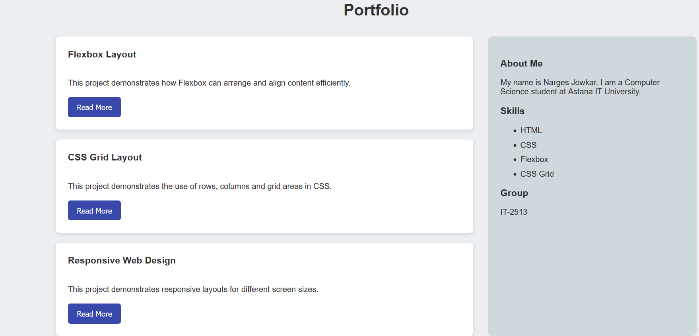
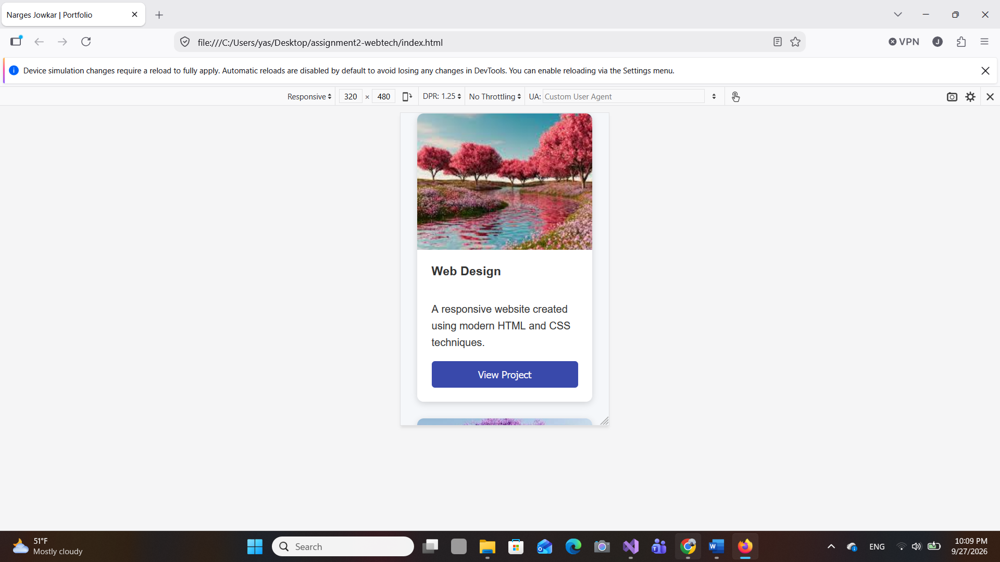

# Web Technologies Assignment 2

## Student Information

**Name:** Narges Jowkar  
**Group:** IT-2513  

## Assignment Topic

Advanced CSS Layouts: Flexbox and CSS Grid

## Objective

The objective of this assignment is to practice modern CSS layout techniques using Flexbox and CSS Grid. The project demonstrates responsive layouts, alignment, grid structures, image galleries, and the combination of Flexbox and Grid.

---

## Task 1 — Flexbox Card Row

I created a responsive row containing three cards using CSS Flexbox.

The cards include:
- An image
- A heading
- A short description
- A button

Flexbox is used to arrange the cards in a row with equal spacing and consistent alignment. A hover effect is also applied to the cards.

### Screenshot

---

## Task 2 — CSS Grid Page Layout

I created a page layout using CSS Grid.

The layout contains:
- Header
- Sidebar
- Main content area
- Footer

Named grid areas are used to organize the different sections of the layout.

### Screenshot

---

## Task 3 — Responsive Image Gallery

I created a responsive image gallery using CSS Grid.

The gallery contains nine images arranged in a three-column layout on larger screens. The number of columns changes on smaller screens using media queries.

Each image also includes a caption that appears when the user hovers over the image.

### Screenshot

---

## Task 4 — Portfolio Layout

I created a portfolio section that combines CSS Grid and Flexbox.

CSS Grid is used for the main two-column structure, while Flexbox is used to organize the project items inside the portfolio.

The portfolio contains:
- Project information
- About Me section
- Skills
- Student group information

### Screenshot

---

## Responsive Design

Media queries are used to adapt the website to smaller screen sizes.

On smaller screens:
- Navigation elements adapt to the available width.
- Flexbox cards stack vertically.
- The CSS Grid page becomes a single-column layout.
- The image gallery changes from three columns to two columns and then one column.
- The portfolio layout changes to one column.

### Screenshot

---

## Work Process

I first created the HTML structure for the different parts of the assignment. I then used CSS Flexbox for one-dimensional layouts such as the navigation, card row, and project elements.

CSS Grid was used for two-dimensional layouts including the page structure, image gallery, and portfolio layout.

Finally, I added media queries to make the website responsive on different screen sizes and tested the layout using the browser's responsive design tools.

## Technologies Used

- HTML5
- CSS3
- Flexbox
- CSS Grid
- Media Queries
- GitHub

## Project Structure

    assignment2-webtech/
    ├── index.html
    ├── style.css
    ├── README.md
    ├── images/
    │   ├── image1.jfif
    │   ├── image2.jfif
    │   ├── image3.jfif
    │   ├── image4.jfif
    │   ├── image5.jfif
    │   ├── image6.jfif
    │   ├── image7.jfif
    │   ├── image8.jfif
    │   └── image9.jfif
    └── screenshots/
        ├── task1.png
        ├── task2.png
        ├── task3.png
        ├── task4.png
        └── responsive.png

## Conclusion

This assignment demonstrates the use of Flexbox and CSS Grid to create modern, structured, and responsive web layouts without using external CSS frameworks.